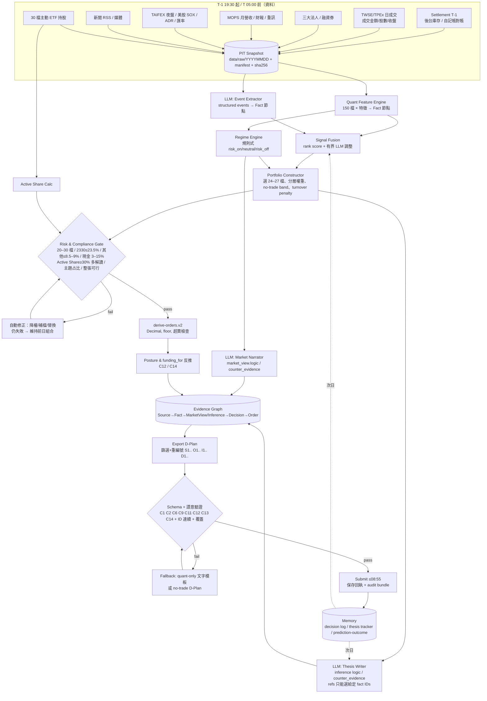

# 07 Agent Architecture 建議

## 1. 三種架構比較

| 面向 | A. Single LLM Agent | B. Multi-Agent（LLM 角色辯論） | C. Hybrid Quant + LLM |
|---|---|---|---|
| 描述 | 一個 LLM 帶工具，自行查資料、選股、給權重、寫 D-Plan | 多個 LLM 角色（分析師、多空、交易員、風控、PM）協作 | 確定性程式負責資料/數值/組合/限制/委託；LLM 負責文字理解、事件、敘述、反方論點 |
| 150 檔橫斷面 | 差：context 放不下、排序不穩定 | 很差：成本 ∝ 檔數×角色×回合 | 好：程式一次算完 150 檔 |
| 硬限制（整張、10%/25%、現金、檔數、AS） | 易錯 | 易錯 | 由程式保證 |
| C2/C12/C14 數學檢核 | 高風險 | 高風險 | 程式反推，0 風險 |
| 可重現性 | 低（非決定性） | 更低 | 高（數值部分完全決定性；LLM 部分以 log replay） |
| Auditability | 中（事後合理化風險） | 中 | 高（evidence graph） |
| 成本/時間（每日 08:55 前） | 中 | 高 | 低～中 |
| 證據支持 | FINSABER：純 LLM alpha 在嚴格測試下消失 | TradingAgents 論文樣本極小 | Romanko 2023、ai-hedge-fund v2 重寫方向、Man Group AlphaGPT、LLM 數值弱點文獻 |
| 自主性（無人為介入） | 是 | 是 | 是（全流程自動；規則由 Agent 設計時決定） |
| 複賽簡報「Agent 技術架構」 | 簡單 | 吸睛 | 清楚且可辯護；可包含少量 LLM 角色 |

**推薦：C（Hybrid）為骨幹，在 LLM 層內使用「少量、固定、有明確輸入輸出」的角色**（不是自由對話的 multi-agent）。

## 2. 是否需要 Multi-Agent？
**不需要大規模 multi-agent。** 建議 LLM 只有 3 個固定角色（同一個模型、不同 prompt），全部是 pipeline 中的函式呼叫：
1. **Event Extractor**：新聞/重訊/法說文字 → 結構化事件（ticker、類型、方向、時效、可信度、published_at）。
2. **Market Narrator**：拿到程式算好的市場級 facts 與 regime → 撰寫 `market_view.logic` 與 `counter_evidence`。
3. **Thesis Writer（含 bull/bear 自我反駁）**：對被選中/被調整/續抱的標的，依程式提供的 fact IDs 撰寫 inference `logic` 與 `counter_evidence`；可產生一個有界的「LLM 調整分數」（例如 −1/0/+1）。

可選第 4 個：**Reviewer**（檢查 D-Plan 文字是否引用數字、是否與理念一致；只能退回重寫，不能改數值）。

## 3. Agent Architecture v1

## 4. Data Flow
1. **Ingest**（T-1 19:30 後與 T 04:00–05:30）：官方資料、夜盤、美股、新聞、ETF 持股 → `data/raw/YYYYMMDD/` + manifest（url、fetched_at、content_as_of、published_at、sha256）。
2. **PITView**：所有下游只透過 `as_of = T 08:55`（實際以 run 開始時間）的視圖存取。
3. **Facts**：程式產生數值事實（每檔特徵、市場級事實）；LLM 產生事件事實（結構化，數值欄位僅限可從原文直接取得者，例如營收 YoY 由程式重算覆核）。
4. **Scores → Target Portfolio → Orders**：全程式。
5. **Narratives**：LLM 只寫文字欄位，輸入是已決定的結果與被允許引用的 fact IDs。
6. **Export & Validate & Submit**。

## 5. Decision Flow（每日）
1. 讀前日結算持股/現金/NAV（與自記帳對帳；不一致 → 以官方為準並告警）。
2. Regime：決定目標現金區間與總曝險（例如 risk_off → 現金 10–15%）。
3. 150 檔分數 → 候選池；現有持股依 thesis tracker 檢查失效條件。
4. Portfolio constructor：維持型（持股分數仍在前 N+buffer 則保留）+ 換入（新進前 N 且分數差 > 換手成本門檻）。
5. 權重：分層（core/satellite）或分數比例，套用上限與緩衝 → 整張可行性調整。
6. Gate：全部硬限制 + Active Share + 主題一致性；失敗自動修正或 fallback。
7. 決策分類：BUY/ADD/TRIM/SELL_ALL/no_trade（依前日持股與目標股數差）。
8. derive-orders.v2 → posture、funding_for 反推。
9. LLM 撰寫文字 → export → 驗證 → 提交。

## 6. Agent Responsibilities

| 元件 | 類型 | 負責 | 不得負責 |
|---|---|---|---|
| Data Pipeline | Deterministic | 抓取、快照、時間戳、健康檢查 | — |
| Feature Engine | Deterministic | 動能、相對強弱、52 週高、量能、波動、法人、月營收驚奇、產業動能、隔夜敏感度 | — |
| Event Extractor | LLM | 文字 → 結構化事件 | 數值計算、權重 |
| Signal Fusion | Deterministic | 分數合成，LLM 調整有上限 | — |
| Regime Engine | Deterministic | regime/stance/目標現金 | — |
| Market Narrator | LLM | market_view 文字 | posture 數值 |
| Portfolio Constructor | Deterministic | 選股、權重 | — |
| Risk & Compliance | Deterministic | 全部硬限制、AS、主題、時間 | — |
| Order Deriver | Deterministic | derive-orders.v2 | — |
| Thesis Writer | LLM | inference 文字、counter_evidence | 新增 refs、改數字 |
| Reviewer（可選） | LLM | 文字品質檢查 | 改決策 |
| Exporter/Validator | Deterministic | ID 重編、schema、C 檢查 | — |
| Memory | Deterministic + LLM 摘要 | 日誌、thesis 狀態、預測結果；LLM 只寫摘要 | 修改規則或硬參數 |

## 7. Deterministic vs LLM 分界（總結）
- **Deterministic**：market data、價格、技術指標、量化特徵、排名、組合建構、部位大小、交易成本、NAV、Active Share、現金、硬限制、委託計算、posture/funding_for、D-Plan 結構與驗證、ID 編號。
- **LLM**：新聞/重訊/法說解讀、事件分類與時效判斷、市場敘事、thesis 與反方論點、（有界）事件調整分數、反思摘要、ETF 投資策略說明文件撰寫。
- 依據：`raw_notes/hybrid_vs_pure_llm_evidence.md`（LLM 數值/非決定性弱點、Hybrid 實證）、`repo_notes/ai-hedge-fund.md`（v2 分工）、FINSABER（LLM 擇時不可靠）。

## 8. Failure Handling

| 失敗 | 偵測 | 處理 |
|---|---|---|
| 資料源失敗/延遲 | manifest 缺檔、健康檢查 | 備援來源；若仍缺 → 使用前一日資料並在 statement 標註時點；關鍵資料（收盤價/持股）缺 → no-trade D-Plan |
| 前日結算持股取得失敗 | — | 使用自記帳；所有 SELL 加安全檢查；若不確定 → 不賣出、只做 no-trade |
| LLM timeout/限流/格式錯誤 | 重試 3 次 + schema 驗證 | 切換備援模型（若事先版本化）或 **quant-only 文字模板**（程式產生 logic 文字）|
| LLM 引用不存在 ID | 驗證器 | 重新生成一次；仍錯 → 模板 |
| Optimizer 無可行解 | — | 放寬軟約束（turnover、主題）→ 仍無解 → 維持前日組合（no_trade 全部） |
| 驗證失敗（C 檢查） | 自建 validator | 自動修正；否則 fallback |
| 時間不足（07:30 未完成） | watchdog | 立即提交最後一個合法版本（例如 05:30 先產出的保守版本） |
| 提交失敗 | 回執檢查 | 重試；保留 ≤25 次額度 |
| 價格漂移超限 | 每日持股權重檢查 | 5 交易日寬限內排程減碼（預設次日處理） |

**兩段式提交**：約 05:30 先產生並提交「保守版」（quant-only、完整合法），約 07:00 若 LLM 增強版完成且通過驗證，再覆蓋提交（最後一次為準）。→ 大幅降低漏交風險（需確認 NC-10）。

## 9. 自主性與稽核設計
- 全流程排程自動執行；人只負責基礎設施（開機、網路、提交機制若需人工按鈕）。
- 策略參數與 prompt 在賽前凍結於 git；`code_version = git:<sha>`；dirty working tree 禁止執行。
- 每日 audit bundle：raw snapshot hashes、features、scores、optimizer 輸入輸出、LLM prompts/responses（含 model id、參數、token）、D-Plan、驗證報告、提交回執。
- 比賽中只允許 bug/資料源修復（記錄理由、換版）；不因績效手動改策略方向。

## 10. 本輪不決定
- 具體 LLM provider/模型（候選：Gemini via GCP credit、其他 API）、是否使用 agent framework、optimizer 是否用 cvxpy —— 留待 Phase 5/7 實測後決定。
